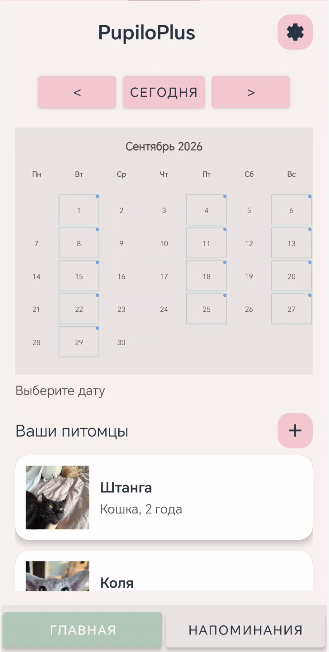

# Быстрый старт

**Кому:** новый пользователь, который хочет начать работу с PupiloPlus как можно быстрее.

### Что вы получите через 5 минут

- Приложение установлено и запущено
- Создана первая заметка и напоминание
- Настроены базовые уведомления

## Требования

- Windows 10/11 или совместимая ОС
- ~200 МБ свободного места

## Быстрая последовательность действий

1. Скачайте архив приложения или получите установщик от администратора.
2. Запустите `PupiloPlus.exe` и следуйте мастеру установки.
3. Запустите приложение и создайте учётную запись (или пропустите регистрацию для локальной работы).
4. Нажмите кнопку «+» и заполните поля заметки: заголовок, текст, метки и при необходимости дату напоминания.
5. Проверьте уведомление, создав напоминание на ближайшее время.

Пример командной утилиты (если используете портативную версию):

```bash
./PupiloPlus.exe --create-sample
# Создаёт демо-данные: 3 заметки, 2 напоминания
```

Ожидаемый результат: после запуска вы увидите список заметок на главном экране, а созданное напоминание появится в списке и сработает в указанное время.


*Рис. 2 — Пример реального главного экрана после первого запуска с демонстрационными заметками.*

[← Вернуться на главную страницу](index.md)

Подробнее об установке: [Установка и настройка](installation.md)

---

## Подробные шаги с подсказками

1) Запуск установщика

- Дважды кликните `PupiloPlus-installer.exe`.
- На шаге выбора папки рекомендуем оставить путь по умолчанию — это упростит обновления.

2) Первая инициализация

- При первом запуске приложение предложит создать аккаунт. Для локальной работы нажмите `Пропустить`.
- Если создаёте аккаунт — введите рабочий e‑mail и надёжный пароль (через 8 символов, заглавные буквы, цифры).

3) Создание заметки — подробный пример

- Откройте форму создания (`+` или `Ctrl+N`).
- В поле `Заголовок` введите: «Сдать лабораторную по физике».
- В поле `Текст` опишите шаги: «Проверить расчёты, приложить графики, выгрузить в PDF».
- В поле `Метки` укажите: `учёба, физика`.
- В `Напоминание` выберите дату и время, затем нажмите `Сохранить`.

4) Настройка уведомлений

- Откройте `Настройки` → `Уведомления`.
- Включите `notifications.enabled: true` в `config.yaml` если хотите локальные пуши.

5) Экспорт и резервное копирование

- Экспорт: `Файл` → `Экспорт` → выберите `JSON` или `CSV`.
- Для восстановления: `Файл` → `Импорт` и выберите ранее сохранённый файл.

Если нужно, добавлю скриншоты для каждого шага формы создания заметки и настроек.
