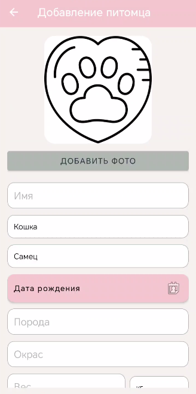
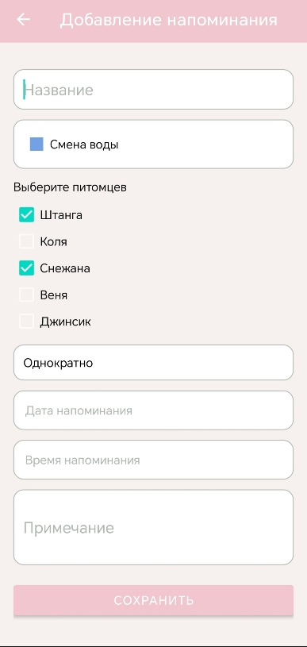
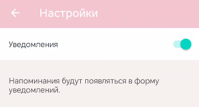
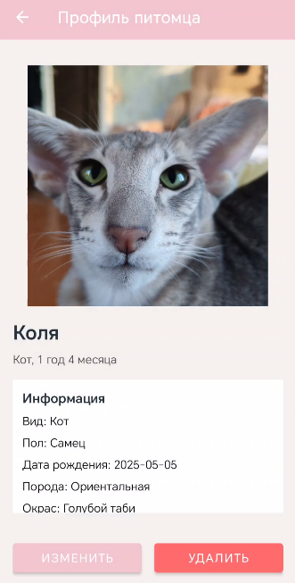
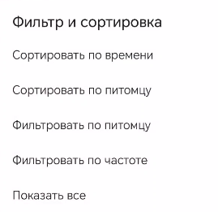
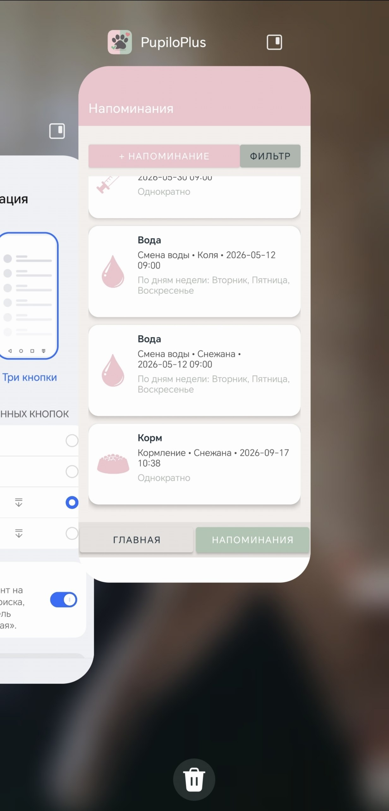
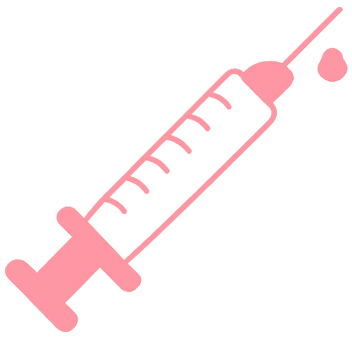

# Скриншоты и изображения

Ниже — галерея изображений интерфейса и иконок, взятых из приложения. Нумерация сквозная и согласована с другими разделами документации.

## Скриншоты интерфейса

*Рис. 2 — `images/main_screen.png`. Главный экран приложения: панель инструментов, строка поиска, список заметок. Используется в быстром старте и как ориентир работы с приложением.*

*Рис. 4 — `images/add_pet_screen.png`. Экран создания записи (пример «Добавить питомца»): заголовок, текст, метки, выбор изображения. Показан пример валидного заполнения полей.*

*Рис. 5 — `images/add_reminder_screen.jpeg`. Форма создания напоминания: выбор даты/времени, повторов, параметров оповещения и кнопка подтверждения.*

*Рис. 6 — `images/settings_screen.png`. Экран настроек: включение/отключение синхронизации, управление уведомлениями и прочие параметры.*

*Рис. 7 — `images/pet_profile_screen.png`. Детальная страница записи: история напоминаний, прикреплённые файлы и быстрые действия (редактировать/удалить).*

*Рис. 8 — `images/notification_example.png`. Внешний вид системного уведомления в Windows: текст напоминания и кнопки действия (отложить, закрыть).*

*Рис. 9 — `images/filters_and_sorting_screen.png`. Панель фильтров и режимов сортировки: выбор меток, диапазона дат, порядок отображения.*

*Рис. 10 — `images/app_exit_screen.png`. Диалог подтверждения выхода: предупреждение о несохранённых изменениях и кнопки подтверждения/отмена.*

## Иконки и ресурсы

*Рис. 11 — `images/ic_water.png`. Иконка «Вода/Полив» — для событий, связанных с пополнением воды.*

*Рис. 12 — `images/ic_pill.png`. Иконка «Таблетка» — для напоминаний о приёме лекарств.*

*Рис. 13 — `images/ic_food.png`. Иконка «Кормление» — для событий, связанных с кормлением питомцев.*

*Рис. 14 — `images/ic_litter.png`. Иконка «Лоток» — для задач по обслуживанию и чистке.*

*Рис. 15 — `images/ic_doctor.png`. Иконка «Врач» — напоминания о посещении специалиста.*

*Рис. 16 — `images/ic_bell.png`. Общая иконка уведомления — используется в заголовке и настройках.*

*Рис. 17 — `images/ic_launcher-playstore.png`. Иконка приложения для публикации в магазине (Play Store).*

[← Вернуться на главную страницу](index.md)
